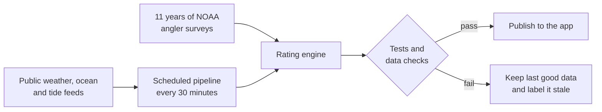

# Flagler Fishing Report

**A fishing forecast app for Northeast Florida, backed by an automated data pipeline that rebuilds it every 30 minutes from public weather, ocean and tide data.** I designed it and built it with AI coding agents. It's live and runs on its own, with no server to maintain.

**Live app:** https://cjn119-ui.github.io/flagler-fishing-report/

<!-- SCREENSHOT 1: phone view of the home screen (GO / MAYBE / SKIP by spot).
     Existing candidates in the repo: site/v5/proto/shots/plan-dark-375.png or spot-sheet-light-375.png -->
<!--  -->

## What I built

1. **The app.** An installable web app that rates 11 beach, pier and inland spots from St. Augustine to Flagler Beach as GO, MAYBE or SKIP. For each spot it shows the best times to go, the fish in season, and closures like piers under repair.
2. **The data pipeline.** A scheduled job pulls forecasts, alerts, buoy readings, wave data and tide predictions from the National Weather Service, NOAA and SECOORA, builds a static data feed, and publishes the site. If the main forecast source is down, it switches to a labeled backup.
3. **The rating engine.** Rules that turn wind, rain, waves, tides, daylight and water temperature into one rating per spot and fishing style (surf, pier or inshore). Weather alerts or out-of-date data block a GO.
4. **The catch history.** Eleven years (2015 to 2025) of NOAA angler surveys, cleaned and turned into "how often do people catch this fish this month" for each species the app covers.
5. **Automated quality checks.** Tests that run before every refresh and a validator that checks the published data before it goes live.
6. **Research tools.** A prediction model and a year-long replay used to test the ratings before trusting them.

## How it works



## What this project shows

- **Automation:** a hands-off pipeline that combines several public data feeds and publishes on a schedule, with retries and fallbacks built in.
- **Data quality:** the survey data was audited against NOAA's own documentation. One fix alone moved the share of ocean shore trips that caught a fish from a reported 13% to 63%, because released fish had not been counted.
- **Validation:** every refresh is tested before it goes live, and bad data never replaces good data.
- **Turning messy data into a decision:** raw weather, tide and survey records become one simple rating a non-expert can act on.
- **Judgment:** a prediction model was built, tested on years it hadn't seen, and kept out of the app because the results weren't strong enough.

<!-- SCREENSHOT 2: desktop view of one spot with its best windows and species.
     Existing candidate: site/v5/proto/shots/desktop-spot-light.png -->
<!--  -->

## Built to be trusted

Every 30 minutes the pipeline ([.github/workflows/pages.yml](.github/workflows/pages.yml)) runs these steps:

1. **Test the code.** The scoring, tide and calculation tests must pass before any data is built.
2. **Check the output.** The run fails if any report date, live reading or rating is stale, missing or out of range.
3. **Retry once.** If a feed was briefly late, it waits and tries again, without loosening the checks.
4. **Fall back safely.** If it still fails, the site keeps the last good data and marks it stale. If even that can't be read, nothing is published.
5. **Raise a flag.** If the data gets more than six hours old, the run fails and opens a GitHub issue.

Two more tests checked the ratings themselves:

- **Year-long replay.** The rating rules were run against a full year of past conditions (October 2025 to September 2026) with targets set in advance: GO on 15% to 40% of days, no month above 70%, every spot at least 3%. GO came out at 30.5% of days. One spot, Vilano Bridge inshore, came in at 0.8%, and it's reported as a miss rather than quietly adjusted. [Report](docs/v5-hindcast-report.md)
- **Prediction model.** It tested whether conditions predict a catch better than the time of year alone. It helped a little for "any fish" and for whiting, and not for other species, so the app doesn't use it. [Report](docs/v5-catch-model-report.md)

## Cleaning the catch history

The survey data needed real cleanup before the app could use it:

- **Released fish weren't counted.** The survey records fish the interviewer saw, fish kept but not shown, and fish released. Counting all three, as NOAA defines them, took the ocean rate from 13% to 63% (585 of 931 trips) and inland from 11% to 44% (770 of 1,742).
- **Records were merged by mistake.** NOAA reuses interview IDs for estimated records. Matching on year, survey period and ID keeps all 2,703 interviews.
- **Estimated records were mixed in.** They are now left out of the main numbers and reported separately.
- **Some months had too few interviews.** Those are blended with nearby months and labeled "low sample" in the app.

Full audit with counts and NOAA sources: [docs/data-qa-mrip.md](docs/data-qa-mrip.md).

## How I built it

I built this with AI coding agents. I set the goal and the rules, directed the agents, reviewed their work and approved the decisions:

- Setting the product rules: what GO means, which safety and freshness checks block it, and the targets it had to hit
- Approving or rejecting each design decision (recorded with dates in [docs/v5-architecture-decisions.md](docs/v5-architecture-decisions.md))
- Reviewing the data audit, model test and replay results

Most of the code was written by the agents.

---

## Under the hood

**Stack:** JavaScript (Node 22) for the pipeline and app, Python with NumPy for the survey history and model work, GitHub Actions, GitHub Pages, and a Capacitor wrapper for an iOS build.

**Data sources:**

- **National Weather Service:** forecasts, alerts and airport observations
- **NOAA NDBC:** offshore buoys
- **NOAA CO-OPS:** tide predictions and water temperature
- **SECOORA:** nearshore wave buoys
- **Open-Meteo:** labeled fallback when NWS forecasts are unavailable (CC BY 4.0)
- **NOAA MRIP:** recreational angler survey history, 2015 to 2025

**Model method (for technical readers):** L2-regularized logistic regression with nested leave-one-year-out cross-validation. "Any fish": Brier skill 0.086 over a monthly baseline, AUC 0.68.

**Run it locally:**

```bash
SITE_URL= node scripts/generate.mjs        # build the report
python3 -m http.server -d site 8000        # or any static file server
node scripts/test-calculations.mjs         # one of the test suites CI runs
```

**Limits:**

- Ratings are a transparent conditions score, not a catch forecast or a safety clearance.
- The angler survey is collected at access points, mostly near the end of a trip. It isn't designed for spot-level estimates, so history is shown by region and season, not by spot.
- The Smith Creek tide station is an inland reference, not an ocean beach tide.

## Technical reference

The notes below are the detailed operating rules for the pipeline and app.

### Layout
- `/` current app: Flagler Fishing V5 (GO / MAYBE / SKIP by spot, species suitability, best times). Served from `site/v5/proto/` through a `<base href>` in `site/index.html`; `/v5/proto/` still works.
- `/classic.html` the previous root app (live conditions, surf / pier and inshore bite outlooks, 7-day outlook).
- `/v1/`, `/v2/`, `/v3/` earlier versions, kept for reference. `/flagler-fishing/` and `/v4/` redirect to `/`.
- `/api/` JSON built by the scheduled workflow; `/shared/` code used by more than one version.

### Reliability checks

Run `node scripts/test-logic.mjs`, `node scripts/test-app.mjs`, `node scripts/test-catch.mjs` and `node scripts/test-calculations.mjs`. CI runs them before generating data and publishing.

`node scripts/test-generated-output.mjs` is a post-generation smoke test: it reads the files in `site/api/` that Pages will serve and fails the deploy if the current/next-day report dates (America/New_York), generation times, live weather/marine/tide readings (default max age 90 min, `MAX_LIVE_AGE_MIN`) or the surf/inshore catch prediction (generated tides + the NWS hourly feed the page uses) are wrong, stale, null or out of range. It prints one PASS/FAIL line per check and writes it to the Actions run summary; an NWS outage while building only warns. `node scripts/test-validator.mjs` tests the validator itself.

If generated-output validation fails, Pages restores the six root API JSON files from the currently deployed site before publishing, so a stale upstream feed cannot replace the last-good root data. The workflow still ends red and opens the scheduled-refresh issue; V5 files generated by that run can still publish. Restoration is fail-closed: if any deployed root API file cannot be fetched and parsed as JSON, the workflow does not deploy.

V5 keeps NWS forecasts and alerts primary. If NWS hourly/grid weather or nearshore waves are stale/unavailable, V5 falls back to Open-Meteo weather and marine forecasts, labels the fallback, and attributes it under CC BY 4.0. Since these endpoints do not expose the model issue time, fallback data cannot satisfy V5's GO freshness or tomorrow-wave issuance gates; use remains conservative until a timestamped NWS forecast returns. Open-Meteo's free API is for non-commercial use; an appropriate plan is required before commercial use.

The root app keeps successful source responses on the device for up to 24 hours of fallback viewing, labels saved data, and still expires airport observations after 2 hours and buoy observations after 3 hours. A failed forecast or alert check cannot produce a green Go, and active caution/warning alerts withhold time suggestions. Forecast windows require wind, rain and tide coverage throughout the interval. The score is a transparent conditions heuristic, not a catch forecast or safety clearance.

The separate bite outlook ranks fully covered, non-overlapping 2-hour windows. Surf / pier uses daylight proximity (45%), forecast wind (30%) and rain chance (25%), never the inland tide. Inshore uses Smith Creek tide movement (35%), light (25%), wind (20%) and rain (20%). The best window is labelled Promising at 0.78+, Mixed at 0.62+, otherwise Slow. These are relative, uncalibrated bands, not measured catch probabilities. Missing forecast or unchecked alerts withhold both views; missing tide data withholds inshore. FWC's regional guide informs seasonal target names, not legal harvest rules. The offshore buoy is current context only, not a local surf forecast.

Smith Creek 8720833 is an inland tide reference; its timings and interpolated movement are not ocean beach tides. NDBC 41117 is an offshore St. Augustine reference. Scheduled GitHub Actions runs can be delayed, so the page checks source observation timestamps rather than treating a successful request or page refresh as proof of fresh data.

### Calculation audit

`node scripts/test-calculations.mjs` checks exact unit conversions, independent weighted-score examples, threshold boundaries, monotonic scores, analytic tide interpolation/rate examples, daylight coverage, forecast gaps and brief wind spikes, 24-hour window limits, weekly date filtering, and repeated DST hours. This runs in CI. An optional directory argument cross-checks downloaded official `points`, `hourly`, `marine`, `tide-gmt`, and `tide-local` JSON fixtures.

Forecast location is Flagler Beach (29.4738, -81.131), resolved through NWS `/points` to JAX 89,29 during the September 30 audit. KFIN remains the separate airport observation. Current-score weights are exactly 45/35/20 for wind/rain/seas, renormalized over known dimensions, rounded once, then constrained by the worst-rule status band. Daily scores use 55/45 for daytime wind/rain. Window weather maxima use every intersecting forecast interval, while tide/light quality uses 30-minute midpoints. Skip-level forecast weather excludes a candidate. Tides are requested in GMT and formatted in New York time, preventing ambiguous repeated local hours.

Sunrise/sunset references were checked against the U.S. Naval Observatory on September 30 and both solstices, within one minute. Summer sunsets belong to the same New York date even when the UTC date is the following day. Report daylight windows stop at sunset; an evening window is omitted when sunset precedes its 6 PM start.
